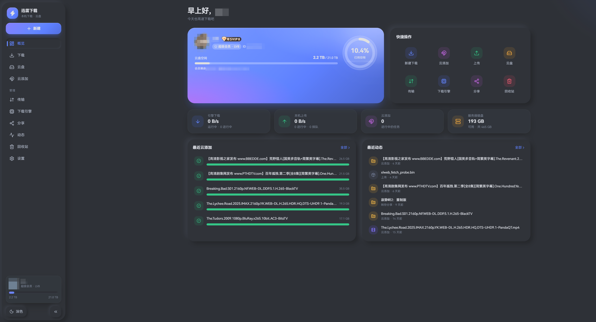
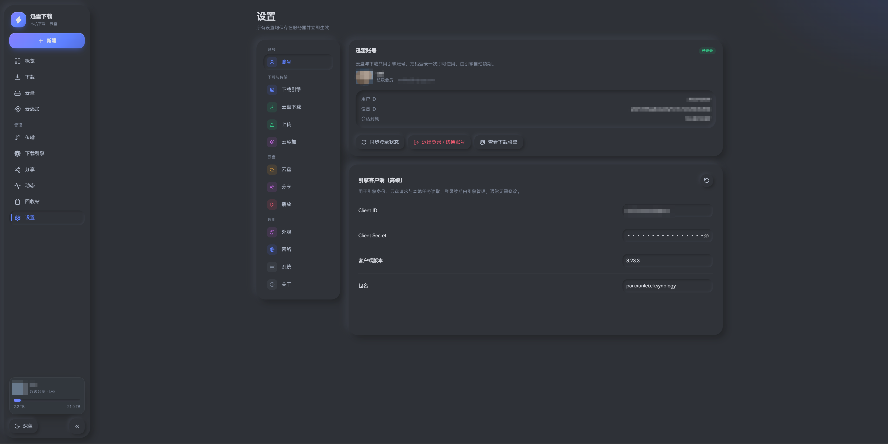
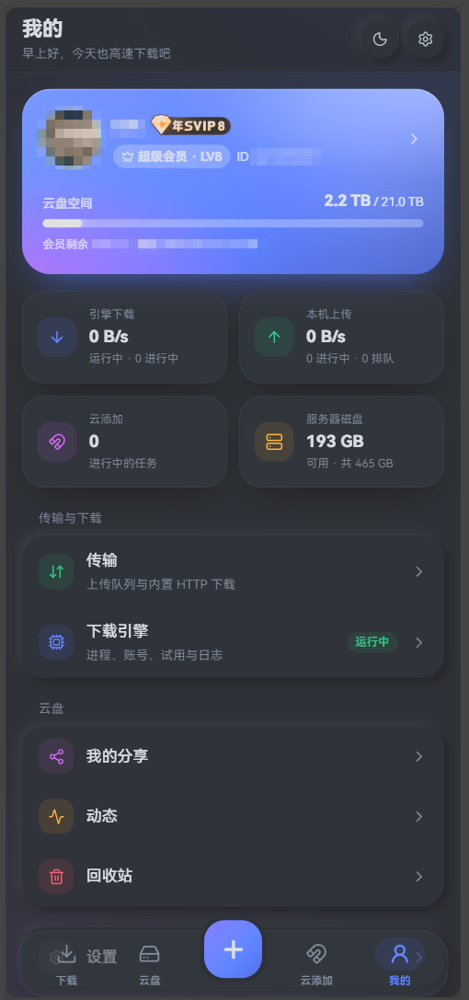
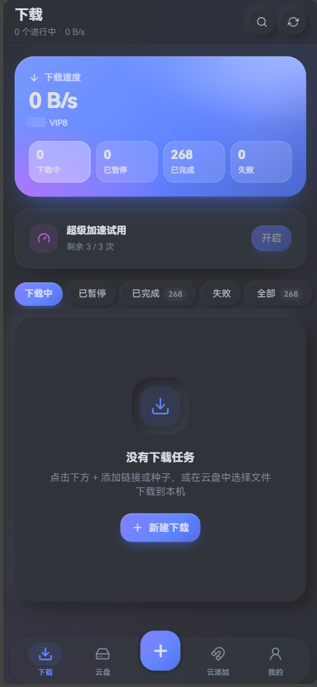

# 迅雷下载 (非官方)

**简体中文** | [English](README.en.md)

一个自托管的迅雷网盘与下载管理 Web 应用：在自己的 Linux 主机上浏览和管理迅雷云盘，用内置的迅雷下载引擎把链接、磁力、种子和云盘文件直接下载到本机。桌面端为侧边栏布局，手机端为原生风格的底部标签栏（操作面板、长按多选、底部弹窗），支持浅色 / 深色主题，并可作为 PWA 安装到桌面或手机主屏。

> 站点本身没有独立登录，只使用迅雷账号登录。任何能访问本站的人都能操作已登录的迅雷账号，请只在可信的局域网中使用。

## 界面预览

<p align="center">
  
  
</p>

<p align="center">
  
  
</p>

## 功能

### 云盘

- 目录浏览：虚拟滚动与无限加载，列表 / 网格两种视图，按名称、修改时间、创建时间、大小排序和筛选
- 分类视图：视频、图片、音频、文档、压缩包、收藏
- 文件操作：新建文件夹、重命名、移动、复制、收藏，删除时可选移入回收站或彻底删除
- 文件详情：大小、GCID、直链、分辨率等信息
- 在线播放、调用外部播放器、复制直链、通过浏览器下载

### 上传

- 在浏览器中上传文件或整个文件夹，保留目录结构
- 上传服务器本机的文件或目录
- 优先秒传，未命中时直传，大文件自动分片并发上传
- 同名冲突可选自动重命名、覆盖或跳过

### 下载

- 支持磁力、HTTP(S)、FTP、ed2k、thunder 链接和 `.torrent` 文件，下载到本机
- 多线程分段下载，支持 BT、P2SP 与会员加速，并显示加速通道
- 种子或磁力可勾选需要的子文件，并自选保存目录
- 暂停、继续、重试、删除任务，删除时可同时删除已下载的文件
- 云盘中的文件和文件夹可以直接取回到本机
- 实时显示进度与速度，支持超级加速试用及一键重置
- 另提供内置 HTTP 下载器：从云盘多线程分段下载，支持断点续传、全局限速、同名冲突策略，下载节点故障时自动换线

### 云添加

- 磁力、HTTP(S)、FTP、ed2k 链接批量提交到云盘离线下载
- `.torrent` 文件先解析预览再提交，可勾选要下载的子文件
- 自选保存位置，任务进度自动刷新，可删除任务（可同时删除文件）

### 下载引擎

- 随服务自动启动并持续守护，异常退出后自动恢复
- 扫码登录一次，云盘与下载共用同一账号，会话自动续期
- 查看引擎状态、下载目录、磁盘占用、运行日志，并检测冲突进程
- 可在设置中切换运行平台，保存后引擎自动重启

### 分享

- 创建分享：设置有效期、提取码和转存次数
- 分享列表：查看浏览和转存统计，复制链接，取消分享

### 回收站与动态

- 回收站：恢复、彻底删除、清空
- 动态：云盘变更的时间线

### 账号与概览

- 迅雷账号扫码登录、退出与切换
- 概览页展示会员等级、空间用量、最近的云添加与动态，以及常用功能入口

### 设置

所有设置都可以在网页上修改，保存后立即生效：

| 分类 | 内容 |
|---|---|
| 账号 | 登录状态、退出与切换账号 |
| 下载引擎 | 下载目录、限速、并发、进程与运行环境 |
| 云盘下载 | 下载方式（引擎 / 内置下载器）、同名冲突策略 |
| 上传 | 秒传、分片大小、并发数 |
| 云添加 | 默认保存位置、刷新间隔 |
| 云盘 | 默认视图、排序、删除方式 |
| 分享 | 默认有效期、提取码 |
| 播放 | 外部播放器、自动播放 |
| 外观 | 主题、强调色、密度、动画 |
| 网络 | 代理、超时、重试、域名直连 IP、UA |
| 系统 | 本机可访问的目录范围 |

## 环境要求

- Linux 主机（仓库自带 arm64 版下载引擎，其他架构见下文「下载引擎」）
- [uv](https://docs.astral.sh/uv/)（Python 3.12+ 后端）
- [Bun](https://bun.sh/)（前端）
- Bash 4.3+，用于运行启动脚本

## 快速开始

```bash
git clone git@github.com:maomaozi/new_xunlei.git
cd new_xunlei

./start.sh --prod   # 构建前端并启动服务：http://127.0.0.1:8011
./start.sh          # 开发模式：前端 http://127.0.0.1:5176 ，API 文档 http://127.0.0.1:8011/docs
```

脚本会自动安装依赖，并在首次运行时用 `.env.example` 生成 `.env.development`。局域网内访问请把地址换成本机 IP。

首次打开页面后，在「设置 → 账号」或「下载引擎」页用迅雷 App 扫码登录，云盘与下载共用这一个账号。

### 分别启动前后端

```bash
cd backend && uv sync --locked && uv run uvicorn app.main:app --host 0.0.0.0 --port 8011
cd frontend && bun install --frozen-lockfile && bun --bun run dev
```

### 开机自启（systemd 用户服务）

```bash
./install-service.sh
```

脚本会构建前端、安装 `xunlei-web.service` 用户服务并启用 linger，开机自动运行，监听 `0.0.0.0:8011`。

```bash
systemctl --user status xunlei-web.service
journalctl --user -u xunlei-web.service -f
```

## 下载引擎

后端启动时会自动拉起并守护 `engine/` 目录中的迅雷下载引擎，运行数据保存在 `backend/data/engine`，状态可在「下载引擎」页查看。

- 仓库自带 linux/arm64 版本；其他架构请按 [engine/README.md](engine/README.md) 放入对应的引擎程序，或在「设置 → 下载引擎 → 引擎程序路径」中指定
- 同一个设备 ID 同时只能有一个引擎在线，使用前请先停止其他 NAS 版迅雷
- 「设置 → 下载引擎 → 进程与运行环境」可选择运行平台（威联通 QNAP、群晖 Synology、通用平台、Linux），保存后引擎自动重启
- 退出登录会同时影响云盘与下载；引擎停止或会话过期时，云盘功能暂不可用，重新登录即可恢复

## 配置与数据

- 运行时行为都在网页「设置」中修改，保存在数据库里，立即生效
- 进程级配置（数据目录、CORS、日志级别、是否自动启动引擎等）写在 `backend/.env.development`，参考 `backend/.env.example`
- 所有运行数据位于 `backend/data/`（已加入 `.gitignore`）：
  - `xunlei_web.sqlite3`：设置、账号和传输任务
  - `uploads/`：浏览器上传的暂存文件
  - `engine/`：下载引擎的运行数据

## 技术栈

- 后端：Python 3.12+、FastAPI、Pydantic v2、httpx、SQLite，使用 uv 管理依赖
- 前端：React、TypeScript、Vite、React Router、Ant Design、Tailwind CSS v4、TanStack Query，使用 Bun 管理依赖

## 目录

```text
backend/            FastAPI 后端
frontend/           React 单页应用
engine/             内置迅雷下载引擎（linux/arm64）
docs/               文档
start.sh            一键启动（开发 / --prod）
install-service.sh  安装 systemd 用户服务
```

## 开发与检查

```bash
cd backend && uv run ruff check . && uv run ruff format --check . && uv run mypy && uv run pytest
cd frontend && bun --bun run lint && bun --bun run test && bun --bun run build
```
